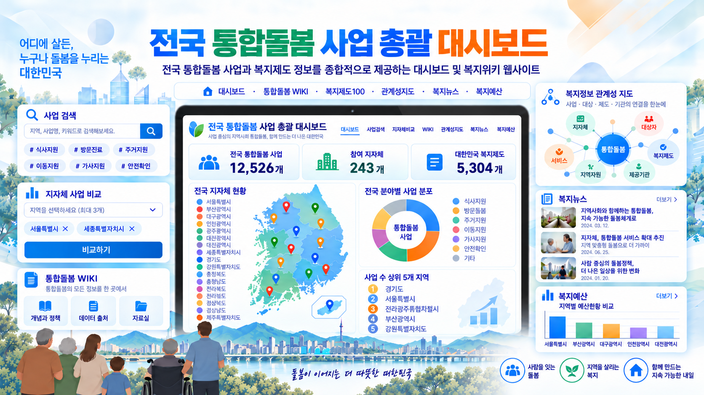

<p align="center">
  
</p>


# 전국 통합돌봄 사업 총괄 대시보드

전국 지방자치단체의 통합돌봄 사업과 대한민국 복지제도 정보를 한곳에서 검색하고 비교하는 웹사이트입니다.

- 운영 사이트: <https://integrated-care-national-dashboard.xgfox54.chatgpt.site>

## 화면

| 화면 | 주소 | 내용 |
|---|---|---|
| 대시보드 | `/` | 광역시·도와 시·군·구별 통합돌봄 사업 현황, 지도, 분야별 분포, 지자체 비교, CSV 내려받기 |
| 통합돌봄 WIKI | `/wiki` | 사업별 설명·대상·신청 방법과 근거 자료 |
| 복지제도100 | `/welfare100` | 복지로에 등록된 중앙부처·지자체 복지서비스 전체와 주요 제도 100개의 업무구조도 |
| 데이터 출처 | `/sources` | 자료 출처와 현행화 방식 |

접속한 지역(모바일은 위치 동의 시 GPS, 그 밖에는 접속 IP 기준)의 광역시·도 자료를 먼저 보여 주고, 나머지 지역은 가나다 순서로 미리 받아 둡니다. 브라우저의 데이터 절약 모드가 켜져 있으면 미리받기를 하지 않습니다.

## 기술 구성

- [vinext](https://github.com/cloudflare/vinext)(Next.js App Router 호환) + React 19
- Cloudflare Workers, D1(SQLite)
- Tailwind CSS 4, shadcn/ui 일부 부품
- 테스트: Node.js 내장 테스트(`node --test`)

## 폴더 구조

| 경로 | 내용 |
|---|---|
| `app/` | 화면과 API 경로 |
| `components/` | 화면 부품(대시보드, WIKI, 복지제도100) |
| `lib/` | 자료 수집·보정·검색, 지역 순서, 복지제도 모델 |
| `worker/` | Worker 진입점(매시 정각 자료 현행화) |
| `data/` | 보건복지부 기준 자료, 복지제도 편집 자료, 복지톡 DB 발췌 |
| `public/data/` | 화면이 바로 읽는 정적 자료(요약, 복지제도 색인·상세, 시도 경계) |
| `drizzle/` | D1 스키마 마이그레이션 |
| `scripts/` | 자료 생성·빌드 보조 스크립트 |

## 로컬 실행

Node.js 22.13 이상이 필요합니다.

```bash
npm run install:ci   # 의존성 설치
npm test             # 단위 테스트
npm run build        # 빌드(dist/)
npm start            # 빌드 결과를 로컬 Worker로 실행
```

로컬 D1에 표를 만들려면 빌드 후 `drizzle/`의 SQL을 번호 순서대로 적용합니다.

```bash
for file in drizzle/*.sql; do
  npx wrangler d1 execute DB --local --persist-to .wrangler/state --config dist/server/wrangler.json --file "$file"
done
```

자료가 비어 있으면 첫 요청 때 보건복지부 공식 자료 수집을 뒤에서 시작합니다. 공공데이터포털 지자체 복지서비스 API는 보조 자료로 쓰며, 쓰려면 배포 환경변수 `PUBLIC_DATA_SERVICE_KEY`에 인증키를 넣습니다(인코딩된 키면 `PUBLIC_DATA_SERVICE_KEY_ENCODING=encoded`). 인증키는 저장소에 넣지 마세요.

## 자료 출처

- 보건복지부 통합돌봄 사업안내 지역별 문서: <https://www.mohw.go.kr>
- 공공데이터포털 한국사회보장정보원 지자체 복지서비스 API
- 복지로 복지서비스(중앙부처·지자체): <https://www.bokjiro.go.kr>
- 복지톡 DB: 보건복지부 사업안내 매뉴얼
- 시도 경계: 통계청 2018 경계를 가공한 [southkorea-maps](https://github.com/southkorea/southkorea-maps)
- 지도 도형: [@svg-maps/south-korea](https://github.com/VictorCazanave/svg-maps)(CC BY 4.0)

모든 자료는 공공기관이 공개한 자료를 정리·가공한 것입니다. 실제 사업 시행 여부, 지원 대상과 기준은 보건복지부와 해당 지방자치단체의 최신 공식 자료로 확인하세요.

## 공개 범위

이 저장소는 운영 사이트의 공개용 사본입니다. 운영자 전용 관리 기능과 운영 설정은 보안을 위해 포함하지 않았습니다. 그래서 공개본은 공공데이터포털 인증키를 환경변수로 받는 등 운영 사이트와 일부 구현이 다릅니다.

## 보안 문제 제보

보안 취약점을 발견하면 이슈로 공개하지 말고 xgfox54@gmail.com 으로 알려 주세요.

## 함께 쓴 공개 소스

- 복지제도100 화면: [hosungseo/korea100](https://github.com/hosungseo/korea100)을 고쳐 씀(MIT, `components/welfare100/KOREA100-LICENSE`)
- shadcn/ui Tailwind 스타일(MIT, `vendor/shadcn-tailwind-4.13.0.LICENSE.md`)
- Sites Vite 플러그인(MIT, `build/sites-vite-plugin.LICENSE`)
