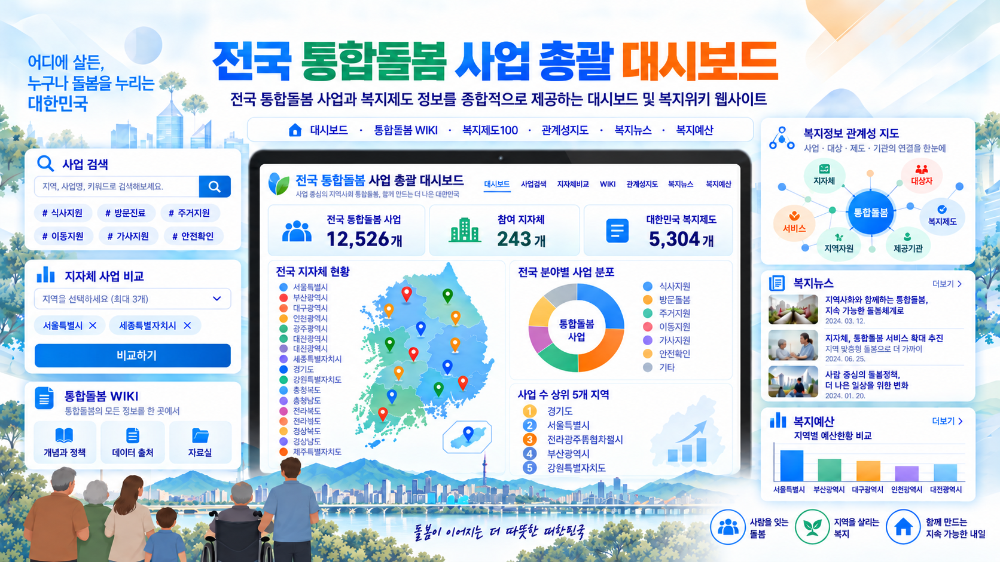
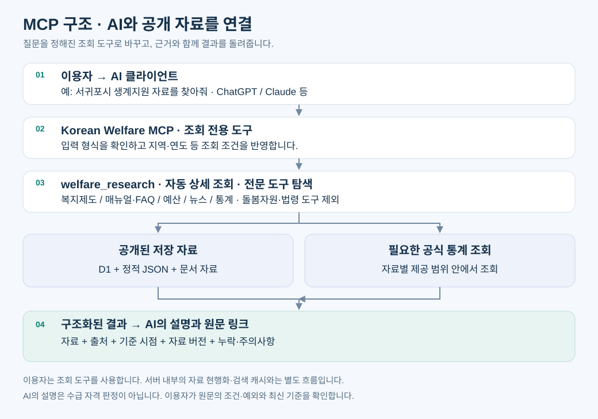
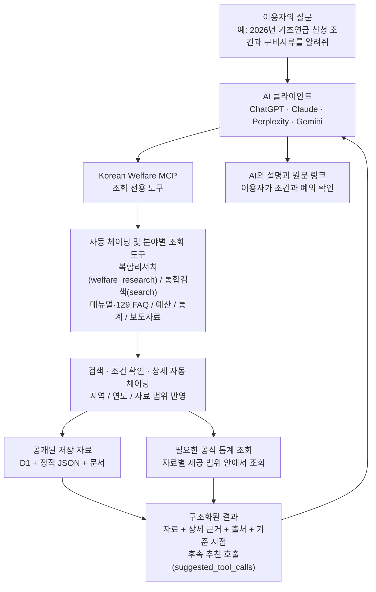
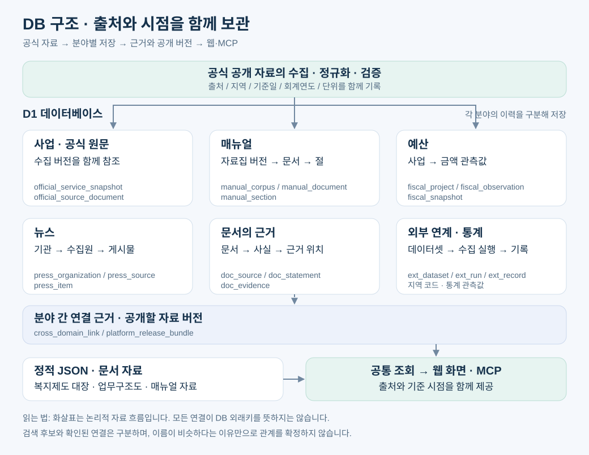
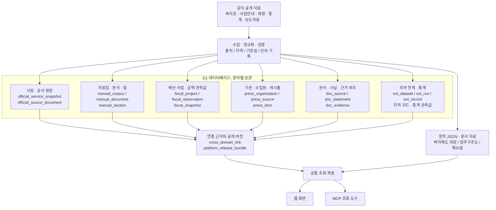

<p align="center"></p>

# 전국 통합돌봄 사업 총괄 대시보드

전국 지방자치단체의 통합돌봄 사업과 복지제도, 보도자료, 예산, 통계를 검색하고 비교하는 업무 참고용 웹사이트입니다. 읍·면·동 민원 상담, 복지서비스 연계, 보고서 작성에 필요한 자료를 출처, 기준일과 함께 보여 줍니다.

같은 자료를 ChatGPT, Claude 같은 AI 앱에서도 조회하도록 **복지정보MCP**(Korean Welfare MCP)를 제공합니다.

[운영 사이트](https://integrated-care-national-dashboard.xgfox54.chatgpt.site) · [시스템 소개](https://integrated-care-national-dashboard.xgfox54.chatgpt.site/info) · [복지제도100](https://integrated-care-national-dashboard.xgfox54.chatgpt.site/welfare100) · [복지정보MCP 안내](https://integrated-care-national-dashboard.xgfox54.chatgpt.site/welfaremcp) · [데이터 출처](https://integrated-care-national-dashboard.xgfox54.chatgpt.site/sources)

> 이 사이트는 서귀포시 소속 직원이 개인적으로 개발해 업무에 활용하는 사례이며, 서귀포시 공식 사이트가 아닙니다. 실제 사업 시행 여부, 지원 대상, 지원 기준은 보건복지부와 해당 지방자치단체의 최신 공식 자료에서 확인해 주세요.

## 현재 버전

2026-11-20에 확인한 내용입니다. 도구는 AI가 자료를 찾을 때 호출하는 조회 기능의 단위입니다.

| 구분 | 복지정보MCP 버전 | AI 앱의 도구 목록에 표시되는 도구 | 실행할 수 있는 전체 도구 | 확인 근거 |
|---|---|---|---|---|
| 운영 사이트 | 1.14.5 | 7개 | 33개 | 운영 서버가 연결할 때 알려 주는 버전과 안내문 |
| 이 저장소의 소스 | 1.14.1 | 16개 | 32개 | [lib/mcp/contract.ts](lib/mcp/contract.ts) |

운영 사이트가 이 저장소보다 새 버전입니다. 이 저장소는 운영 소스에서 관리자 화면과 비밀 설정을 빼고 공개한 사본(공개본)입니다. 1.14.1 이후 운영 사이트에 적용된 변경은 아직 이 저장소에 올라오지 않았습니다.

| 날짜 | 이 저장소에 반영된 변경 |
|---|---|
| 2026-11-20 | 보안 점검 대상 의존성 갱신(Next.js 16.4.6, React 19.3.1, vinext 1.4.6 등), 로컬 인증정보 파일(`.dev.vars`)의 커밋 방지 설정 추가, 내부 배포 점검 문서 1건 삭제 |
| 2026-10-25 | 복지정보MCP 1.14.1 반영. AI에 전달하는 도구 설명 분량을 줄이고, 자동으로 이어서 조회한 근거의 출처·기준일·주의사항을 보존함. [변경 기록](docs/mcp-optimization-1.14.1.md) |
| 2026-10-24 | 복지정보MCP 1.14.0 공개본 반영 |
| 2026-10-16 | 복지통계 지역 지도 추가, 복지제도100의 법령·매뉴얼 연결 재점검. [재점검 기록](docs/welfare100-link-review-20261016.md), [후속 재점검 기록](docs/welfare100-link-review-20261016-round2.md) |

## 화면별 기능

| 화면 | 주소 | 할 수 있는 일 |
|---|---|---|
| 시스템 소개 | `/info` | 기능 안내, 상담 활용 사례, 자료 구성 설명 보기 |
| 대시보드 | `/` | 지도에서 지역을 고르고 통합돌봄 사업을 검색·비교, 검색 결과를 CSV·엑셀(XLSX) 파일로 내려받기 |
| 통합돌봄 WIKI | `/wiki` | 사업별 지원 대상, 제공기관, 사업 내용과 출처 확인 |
| 복지제도100 | `/welfare100` | 주요 복지제도와 중앙부처·지자체 복지서비스 탐색, 제도별 업무구조도와 한 장 요약(캔버스) 보기 |
| 복지뉴스 | `/news` | 기관·기간별 공식 보도자료 검색, 원문으로 이동 |
| 복지예산 | `/budget` | 사회복지·보건 분야 재정 자료와 공개된 예산서 내역 조회 |
| 복지통계 | `/statistics` | 지역 인구와 KOSIS·지표누리 통계 검색, 연도별 추이와 지역 비교 |
| 복지정보MCP | `/welfaremcp` | AI 앱에 등록할 주소, 설치 방법, 질문 예시 확인 |
| 데이터 출처 | `/sources` | 자료별 공식 출처와 갱신 방식 확인 |

보조 화면으로 문서 근거 사실(`/documents`), 개인정보처리방침(`/privacy`), 이용통계 수집 안내(`/usage-policy`)가 있습니다. 지역 돌봄 자원(`/care`), 법령정보(`/law`), 복지정보 관계성 지도(`/mindmap`) 화면은 현재 제공하지 않습니다.

### 대시보드 검색어 입력 방법

| 입력 예 | 찾는 범위 |
|---|---|
| `방문 진료` | 두 단어를 모두 포함한 사업 |
| `노인 or 장애인` | 두 단어 중 하나라도 포함한 사업 |
| `노인*돌봄` | 노인 뒤에 돌봄이 나오는 사업 |
| `돌봄 -요양` | 돌봄을 포함하고 요양은 포함하지 않은 사업 |

검색창에 대상자의 이름, 주민등록번호, 전화번호 같은 개인정보를 입력하지 마세요.

### 민원 상담에 쓰는 순서 예시

혼자 식사를 챙기기 어려운 어르신이 동네에서 받을 수 있는 도움을 문의한 경우입니다.

1. 대시보드에서 거주 지역을 고르고 '식사'를 검색합니다.
2. 통합돌봄 WIKI에서 해당 사업의 지원 대상, 제공 내용, 제공기관을 확인합니다.
3. 현재 운영 여부와 신청 경로를 원문이나 담당 기관에서 확인한 뒤 민원인에게 안내합니다.

## AI 앱에서 조회하기: 복지정보MCP

MCP(Model Context Protocol)는 AI 앱이 외부 자료와 기능을 사용하도록 연결하는 표준입니다. 복지정보MCP를 AI 앱에 등록하면 AI가 질문에 필요한 조회 도구를 호출하고, 대시보드의 자료를 근거로 답변을 구성합니다. 별도 프로그램 설치, 로그인, 인증키는 필요하지 않습니다.

### 등록할 주소

| AI 앱 | 서버 주소 | 인증 방식 |
|---|---|---|
| ChatGPT | `https://integrated-care-national-dashboard.xgfox54.chatgpt.site/chatgpt/mcp` | 인증없음(No authentication) |
| Claude · Perplexity · Gemini | `https://integrated-care-national-dashboard.xgfox54.chatgpt.site/claude/mcp` | 로그인 없음(No sign in) |

두 주소는 AI 앱에 등록하는 연결 주소이며, 웹 브라우저에서 여는 용도로 쓰지 않습니다. 조회할 수 있는 자료와 도구는 두 주소가 같습니다.

### ChatGPT에 연결하는 순서

1. ChatGPT의 플러그인(Plugins) 메뉴에서 추가(+) 버튼을 누르고 Add custom MCP server(사용자 지정 MCP 서버 추가)를 선택합니다.
2. 이름은 `복지정보MCP`로 입력하고, Server URL에 위 표의 ChatGPT 주소를 입력합니다.
3. 인증 방식(Authentication)을 인증없음(No authentication)으로 설정하고 Create as a plugin(플러그인으로 만들기)을 누릅니다.
4. 목록에서 방금 만든 플러그인을 열고 설치(Install)를 선택합니다.
5. 새 대화를 시작해 입력창에 `@`를 입력하고 설치한 플러그인을 선택한 뒤 질문합니다.

계정과 소속 워크스페이스의 정책에 따라 메뉴 표시나 설치 권한이 달라집니다. 예전에 OAuth 방식으로 설치한 플러그인은 2026-10-26부터 제공하지 않으므로, 삭제한 뒤 위 순서대로 다시 등록해 주세요. Claude, Perplexity, Gemini의 단계별 연결 방법과 연결 오류 해결 방법은 [복지정보MCP 안내](https://integrated-care-national-dashboard.xgfox54.chatgpt.site/welfaremcp)에 있습니다.

### 질문 예시

- 복지정보MCP에 현재 수록된 자료의 범위와 기준일, 조회할 수 없는 항목을 알려줘.
- 서귀포시에서 시행하는 통합돌봄 사업을 찾아서 지원대상, 사업 내용, 담당기관과 출처를 정리해줘.
- 2026년 통합돌봄 관련 예산서 사업을 찾아줘. 지역, 본예산·추경 구분, 금액 단위와 원문 근거를 함께 보여줘.
- 복지통계에서 국민기초생활보장 수급자 수의 2021~2025년 추이를 보여줘. 단위, 잠정치 여부, 원문과 확인일을 함께 알려줘.

해당 지역과 연도의 자료가 수록되어 있어야 결과가 나옵니다. 지역, 연도, 사업명을 질문에 적고 출처와 기준일을 함께 요청하면 결과를 비교하기 쉽습니다.

### 조회 범위

| 조회할 수 있는 자료 | 내용 |
|---|---|
| 복지사업과 지원조건 | 지역·대상별 통합돌봄 사업의 지원 대상, 사업 내용, 확인된 근거 |
| 복지제도 | 복지제도 설명과 관련 사업·기관·지역 사이의 확인된 연결 |
| 매뉴얼·상담 자료 | 복지 매뉴얼 본문 구간, 보건복지상담센터(129)의 자주 하는 질문 |
| 예산 | 지방재정365 공개 금액, 승인된 예산서의 사업·금액·산출근거 |
| 통계 | 보건복지부·KOSIS·지표누리 통계의 연도별 수치, 단위, 잠정치 표시 |
| 보도자료 | 제목, 발행기관, 게시일, 원문 링크 |

다음 기능은 제공하지 않습니다.

- 신청 접수, 개인정보 변경, 개인별 수급 자격 판정
- 보도자료 본문과 요약
- 법령·판례·조문 조회, 돌봄자원(장기요양기관·돌봄 수요) 조회

## 수록 자료 현황

2026-11-20에 운영 서버의 자료 현황 조회 도구(`get_dataset_status`)로 확인한 수치입니다. 수집이 진행되면 수치가 바뀌므로, 최신 현황은 [데이터 출처](https://integrated-care-national-dashboard.xgfox54.chatgpt.site/sources) 화면이나 같은 도구로 확인해 주세요.

| 자료 | 수록 규모 | 범위와 기준 |
|---|---|---|
| 통합돌봄 시행사업 | 12,530건 | 보건복지부 통합돌봄 사업안내 문서 230개에서 추출. 16개 시·도, 227개 시·군·구 수록. 원천 자료 기준 2026년 9월 |
| 복지제도 대장(복지제도100) | 5,305건 | 중앙부처 483건, 광역 773건, 기초 4,049건. 기준일 2026-09-24 |
| 정부24 서비스 | 10,891건 | 이 중 상세 내용 수록 6,831건 |
| 복지 매뉴얼 | 문서 113개, 본문 구간 22,003개 | 공식 원본 주소와 PDF 쪽수는 확인되지 않은 상태 |
| 129 상담 자주 하는 질문 | 945건 | 작성일 2024-10-11부터 2026-10-22까지 |
| 공식 보도자료 | 9,828건 | 수집 대상 기관 286곳 중 248곳의 수집 주소 확인. 매일 09·12·15·18시(한국시간) 수집 |
| 예산서 | 문서 452개, 107,644행 | 2023~2026년의 승인·활성화된 문서 |
| 통계 | 통계표 88개, 확인된 관측값 8,248개 | 지표누리 32종, KOSIS 43종, 지역별 인구 3종은 24시간 간격으로 원문 확인 |

사업 수는 수혜자 수, 예산 규모, 서비스 공급량을 뜻하지 않습니다. 보도자료는 모든 기관의 자료를 빠짐없이 수집한 것이 아닙니다.

## 이용할 때 확인할 점

- 업무 참고용 자료입니다. 지원 대상, 금액, 조건은 해당 기관의 최신 원문에서 확인해 주세요.
- 자료의 기준일과 수집일은 다릅니다. 기준일은 자료 내용이 설명하는 시점이고, 수집일은 시스템이 자료를 가져온 시점입니다. 기준일은 출처마다 다릅니다.
- 검색 결과가 없다는 것은 수록되지 않았거나 조회하지 못했다는 뜻이며, 사업이 없다는 뜻이 아닙니다.
- AI의 설명은 행정기관의 수급 자격 판정이 아닙니다. 답변에 제시된 원문에서 조건과 예외를 확인해 주세요.
- 보도자료 발표일을 신청 시작일로 보지 마세요. 신청 시작일은 원문이나 담당 기관에서 확인해 주세요.

## 자료가 화면과 AI 답변에 전달되는 과정

1. 보건복지부, 복지로, 지방재정365, KOSIS 등의 공식 공개 자료를 수집합니다.
2. 형식을 맞추고 검토한 뒤 출처, 지역, 기준일, 단위를 함께 저장합니다.
3. 웹 화면과 복지정보MCP가 같은 저장 자료를 조회합니다.
4. AI 앱에서 질문하면 AI가 조회 도구를 호출하고, 서버가 자료와 출처, 기준 시점을 돌려줍니다.
5. AI가 그 결과로 설명과 원문 링크를 제시하고, 이용자가 원문의 조건과 예외를 확인합니다.



## 개발자용 안내

아래는 소스를 직접 실행하거나 수정하려는 분을 위한 내용입니다.

### 기술 구성과 폴더

vinext(Next.js App Router 호환) + React 19, Cloudflare Workers + D1(SQLite 기반 데이터베이스), Tailwind CSS 4를 사용합니다. 테스트는 Node.js 내장 테스트를 사용합니다.

| 경로 | 역할 |
|---|---|
| `app/`, `components/` | 화면·공개 API·화면 부품 |
| `lib/mcp/` | MCP 계약·자동 체이닝·조회 도구·검색·응답 구성 |
| `lib/manuals/`, `lib/fiscal/`, `lib/press/`, `lib/statistics/` | 분야별 자료 처리와 조회 |
| `db/`, `drizzle/` | DB 모델과 스키마 변경 이력 |
| `data/`, `public/data/` | 공개 자료와 화면용 정적 자료 |
| `worker/`, `scripts/` | Worker 진입점·자료 처리·빌드 보조 |

### 로컬 실행

Node.js는 `package.json`에 지정된 `^22.23.4 || ^24.22.1 || ^26.12.1` 범위가 필요합니다.

```bash
npm run install:ci
npm test
npm run build
npm start
```

로컬 DB에는 `drizzle/`의 SQL을 번호 순서대로 적용합니다. 운영 DB와 별개인 로컬 저장소를 사용하세요.

```bash
for file in drizzle/*.sql; do
  npx wrangler d1 execute DB --local --persist-to .wrangler/state --config dist/server/wrangler.json --file "$file"
done
```

외부 API 인증정보는 실행 환경의 비밀 설정으로 주입합니다. 인증키·환경 파일·로컬 DB·운영 데이터는 저장소에 커밋하지 마세요. 자료 수집에는 제공기관의 이용 조건과 호출 제한이 적용됩니다.

원본 매뉴얼 팩과 비공개 평가 자료는 포함하지 않습니다. 공개본 빌드는 고정된 manifest와 암호문 파일의 경로·크기·SHA-256 및 평문 공개 경로의 부재를 검증합니다. 원문 복호화 검증을 수행했다는 뜻은 아닙니다. 별도 원본 팩이 필요한 통합 테스트 6개 파일은 공개본에서 명시적으로 건너뜁니다. 원본 팩을 보유한 환경에서는 기존 원문 검증 도구와 통합 테스트를 추가로 실행합니다.

### MCP 도구 구성

이 저장소의 소스(MCP 서버 1.14.1, 응답 스키마 2.0) 기준입니다. AI 앱의 도구 목록에 16개를 표시하고, 나머지 전문 도구 16개는 `discover_tools`로 찾아 `execute_tool`로 실행합니다. 복합 질문은 `welfare_research`나 `search(auto_detail=true)`가 검색과 상위 근거의 상세 조회를 이어서 실행합니다. 모든 도구는 조회 전용입니다.

| 목적 | 대표 도구 | 결과 |
|---|---|---|
| 복합 질문 조사 | `welfare_research`, `search(auto_detail=true)` | 통합 검색 후 매뉴얼·사업 맥락·FAQ·예산·통계의 상위 근거를 이어서 조회 |
| 제도·시행사업 찾기 | `search_welfare_services`, `find_programs`, `get_welfare_context` | 제도 설명·지역·대상 조건·정부24 혜택과 근거 |
| 사업안내·상담 근거 찾기 | `search_manuals`, `get_manual_section`, `search_faq`, `get_faq` | 매뉴얼 본문 구간·129 상담 질의응답과 출처 |
| 예산 확인 | `find_budget_projects`, `get_budget_execution`, `search_budget_lines`, `get_budget_breakdown` | 사업·회계연도·금액·단위·예산서 부기와 산출근거 |
| 통계 확인 | `search_statistics`, `get_statistics_data`, `get_statistics_sources` | 통계표·지역·시점·단위·제공기관 |
| 뉴스·온톨로지·출처 확인 | `search_news`, `get_entity`, `get_relationships`, `get_sources` | 보도자료 메타데이터, 개체의 1단계 관계, 원문 출처 |
| 전문 도구 탐색·실행 | `discover_tools`, `execute_tool`, `get_dataset_status` | 전문 도구 탐색·실행과 공개본 기준일 확인 |

운영 서버(1.14.5)는 AI 앱의 도구 목록에 `welfare_research`, `search`, `fetch`, `find_budget_projects`, `search_statistics`, `discover_tools`, `execute_tool` 7개를 표시합니다. 나머지 도구는 `discover_tools`와 `execute_tool`로 실행합니다. 돌봄자원과 법령정보 도구는 운영 서버와 이 저장소 모두 제공하지 않습니다.

온톨로지는 사업, 지역, 예산처럼 자료에 등장하는 대상과 그 사이의 관계를 정의한 목록입니다. [개체·관계 목록](ontology/welfare-v2/schema.json)에 관계의 이름과 대상이 있습니다. 사업 설명의 근거를 찾을 때는 [사실 정보](ontology/v1/statement.schema.json)와 [원문 근거](ontology/v1/evidence.schema.json)를 `statement_id`로 연결한 뒤 문서 버전과 인용문을 확인합니다.

실제 등록 목록은 [lib/mcp/contract.ts](lib/mcp/contract.ts), 체이닝 로직은 [lib/mcp/tool-chains.ts](lib/mcp/tool-chains.ts), 연결 처리는 [lib/mcp/server.ts](lib/mcp/server.ts)를 기준으로 합니다.

<details>
<summary>MCP 흐름도의 Mermaid 표기 보기</summary>



</details>

### DB 구조와 출처·시점 기록

사업·매뉴얼·예산·뉴스를 분야별로 저장하고, 검증된 연결 정보와 공개 버전을 기준으로 함께 조회합니다. 복지제도 대장과 일부 사전 생성 자료는 정적 JSON으로도 제공합니다.

아래는 주요 자료의 논리 구조도입니다. 화살표는 자료 흐름이며 모든 화살표가 DB 외래키를 뜻하지는 않습니다.



<details>
<summary>DB 구조도의 Mermaid 표기 보기</summary>



</details>

아래 표는 자료 묶음별 관계와 조회할 때 확인할 점입니다.

| 자료 묶음 | 관계 | 이용자에게 중요한 점 |
|---|---|---|
| 사업·공식 원문 | 사업과 원문이 `official_sync_run`의 수집 버전을 함께 참조 | 같은 수집 버전이라는 이유만으로 원문과 사업이 직접 연결되는 것은 아닙니다. |
| 매뉴얼 | 자료집 버전별 문서와 해당 절 | 연도·자료집 버전을 구분하고 해당 문서의 근거 절을 확인합니다. |
| 예산 | 사업별 관측값, 공개 스냅샷별 포함 항목 | 회계연도·기준일·단위가 맞는 자료끼리 비교합니다. |
| 뉴스 | 기관별 수집원과 게시물 | 기관·발행일·원문 주소를 확인합니다. 뉴스 전문을 대신 제공하지 않습니다. |
| 문서 근거 | 문서 버전별 사실 정보와 근거 위치 | 설명에 대응하는 원문 인용과 페이지를 확인합니다. |
| 분야 간 연결 | `cross_domain_link`에 관계·근거·검증 상태 기록 | 검색 후보와 확인된 연결을 구분합니다. 이름이 비슷하다고 사업과 예산을 확정 연결하지 않습니다. |
| 공개 버전 | `platform_release_bundle`과 활성 버전 | 함께 제공할 자료 버전을 묶어 조회 결과의 기준을 설명합니다. |

스키마 출발점은 [db/schema.ts](db/schema.ts), 전체 스키마의 변경 이력은 [drizzle/](drizzle/)에 있습니다. 정적 복지제도 대장은 [public/data/welfare100/](public/data/welfare100/), MCP의 대장 조회 코드는 [lib/mcp/welfare-catalog.ts](lib/mcp/welfare-catalog.ts)에 있습니다. README 도식의 SVG 재생성 명령은 `node scripts/architecture-diagrams.mjs`입니다.

### 공개 범위

운영 소스 전체를 바탕으로 공개용 사본을 만들었습니다. 운영자 전용 관리 화면·세션 인증 코드, 배포별 비밀 설정, 비공개 운영·보안 점검 기록은 제외했습니다. 공개본 실행에 필요한 설정과 공개 데이터 처리 코드는 포함합니다. 운영 DB 복제본은 제공하지 않습니다.

## 출처

주요 출처는 [보건복지부](https://www.mohw.go.kr), [복지로](https://www.bokjiro.go.kr), 공공데이터포털, 지방재정365, KOSIS와 공공기관의 공개 자료입니다. 자료별 출처와 갱신 방식은 [데이터 출처](https://integrated-care-national-dashboard.xgfox54.chatgpt.site/sources) 화면에 정리되어 있습니다.

## 오류와 보안 문제 제보

사이트 오류나 사업 정보 오류는 **xgfox54@gmail.com**으로 알려 주세요. 오류가 보인 화면 주소와 사업명을 함께 적어 주시면 확인하기 쉽습니다. 보안 문제는 공개 이슈에 상세 내용을 게시하지 말고 같은 주소로 제보해 주세요.

## 함께 쓴 공개 소스

- 복지제도100: [hosungseo/korea100](https://github.com/hosungseo/korea100), MIT, [라이선스](components/welfare100/KOREA100-LICENSE)
- 지도 도형: [@svg-maps/south-korea](https://github.com/VictorCazanave/svg-maps), CC BY 4.0
- 시도 경계: 통계청 2018 경계를 가공한 [southkorea-maps](https://github.com/southkorea/southkorea-maps)
- shadcn/ui Tailwind 스타일: [MIT 고지](vendor/shadcn-tailwind-4.13.0.LICENSE.md)
- Sites Vite 플러그인: [MIT 고지](build/sites-vite-plugin.LICENSE)
- 그 밖의 고지: [THIRD_PARTY_NOTICES.md](THIRD_PARTY_NOTICES.md)
