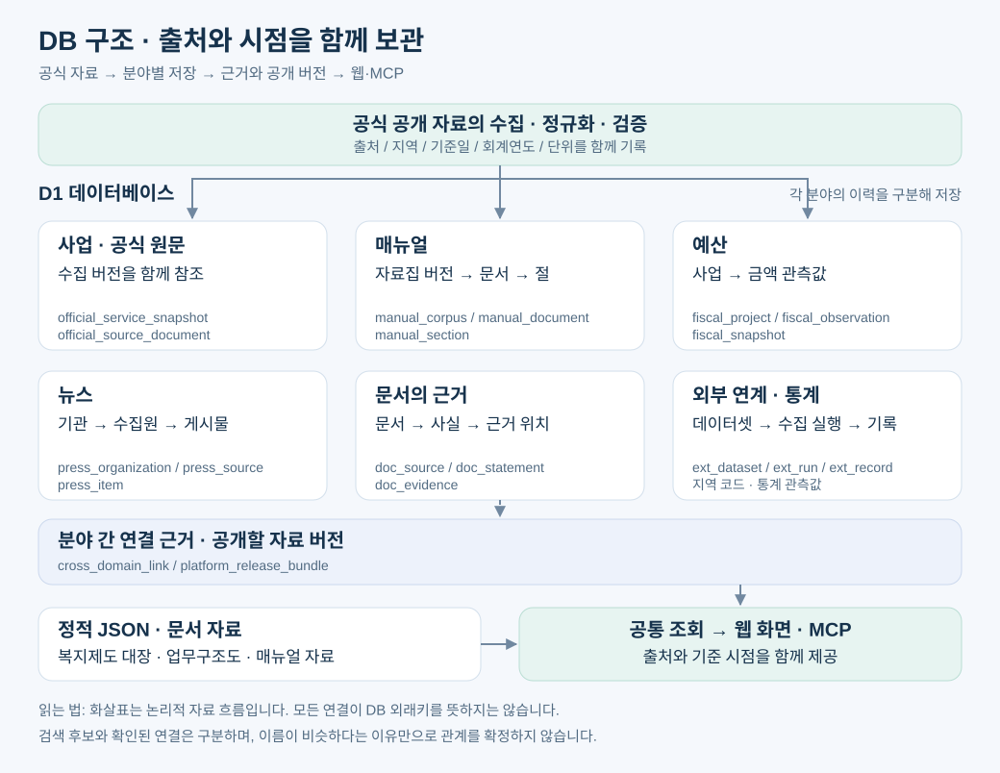
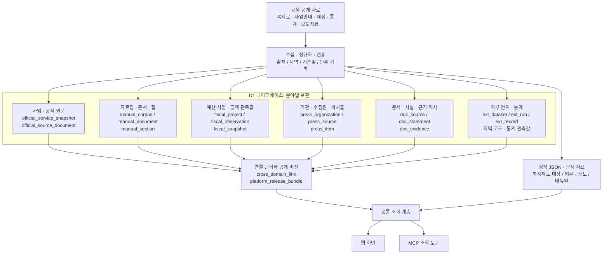
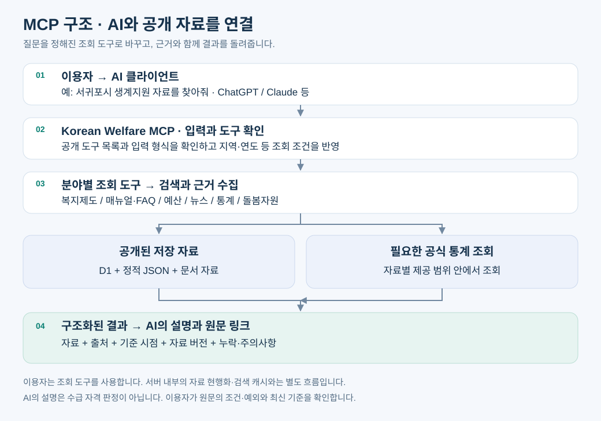
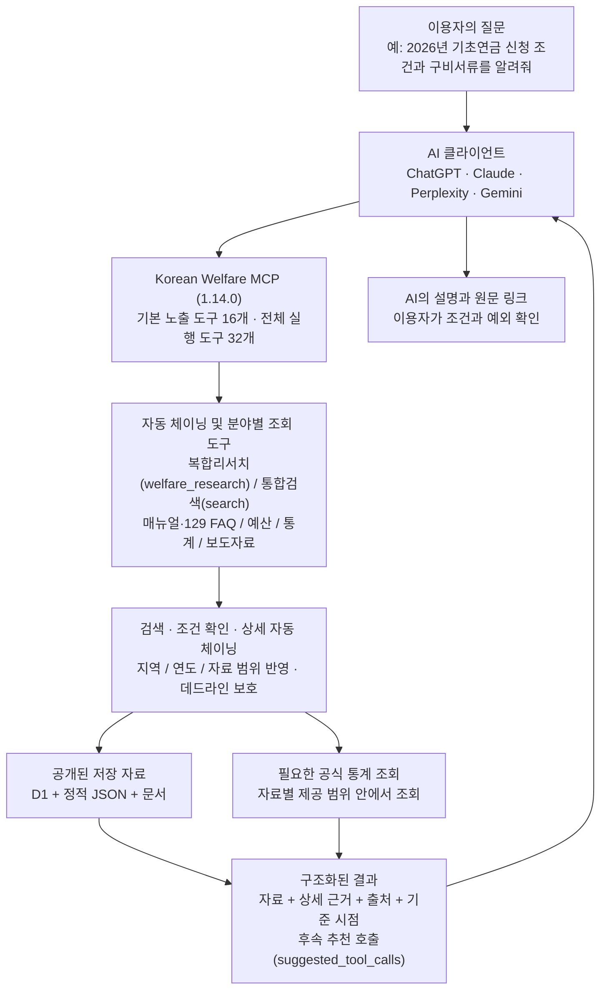

<p align="center"></p>

# 전국 통합돌봄 사업 총괄 대시보드

전국 지방자치단체의 통합돌봄 사업과 복지제도, 뉴스, 예산, 통계를 검색하고 비교하는 업무 참고용 웹사이트입니다. 같은 공개 자료를 AI에서도 조회하도록 **Korean Welfare MCP(복지정보MCP)**를 제공합니다.

[운영 사이트](https://integrated-care-national-dashboard.xgfox54.chatgpt.site) · [복지제도100](https://integrated-care-national-dashboard.xgfox54.chatgpt.site/welfare100) · [복지정보MCP 안내](https://integrated-care-national-dashboard.xgfox54.chatgpt.site/welfaremcp) · [데이터 출처](https://integrated-care-national-dashboard.xgfox54.chatgpt.site/sources)

**2026-10-24 복지정보MCP 자동 툴체이닝 및 도구·토큰 최적화(MCP 1.14.0)를 반영한 공개본**입니다. 돌봄자원과 법령정보는 이용자 제공 범위에서 제외하고, 복합 리서치 자동 체이닝(`welfare_research`), 검색 도구의 자동 상세 연결(`auto_detail=true`), 후속 호출 추천(`suggested_tool_calls`), 1-hop 기본 노출 도구(16개)와 2-hop 전문 도구(`discover_tools`·`execute_tool`, 전체 32개 실행) 구조를 적용했습니다. 이전 법령·매뉴얼 연결 재점검 기록은 [연결 재점검 기록](docs/welfare100-link-review-20261016.md) 및 [후속 재점검 기록](docs/welfare100-link-review-20261016-round2.md)에 정리했습니다. 자료의 기준일은 출처마다 다르며, 소스 동기화 날짜가 모든 자료의 기준일을 뜻하지는 않습니다.

## 이용 화면

| 화면 | 주소 | 내용 |
|---|---|---|
| 대시보드 | `/` | 지역별 통합돌봄 사업, 지도, 분야별 분포, 지자체 비교, CSV 내려받기 |
| 통합돌봄 WIKI | `/wiki` | 사업 설명·지원 대상·신청 방법과 근거 자료 |
| 복지제도100 | `/welfare100` | 중앙부처·지자체 복지서비스, 주요 제도의 업무구조도와 한 장 캔버스 |
| 복지뉴스 | `/news` | 기관 보도자료 검색과 원문 연결 |
| 복지예산 | `/budget` | 공개 재정자료·예산서에 근거한 사업별 예산 탐색 |
| 복지통계 | `/statistics` | 지역·주제별 공식 통계, 요약·비교 차트와 출처 |
| 복지정보MCP | `/welfaremcp` | ChatGPT · Claude · Perplexity · Gemini 원격 MCP 연결 안내 |
| 데이터 출처 | `/sources` | 자료 출처와 현행화 방식 |

## DB 구조와 출처·시점 기록

사업·매뉴얼·예산·뉴스를 분야별로 저장하고, 검증된 연결 정보와 공개 버전을 기준으로 함께 조회합니다. 복지제도 대장과 일부 사전 생성 자료는 정적 JSON으로도 제공합니다.

아래는 주요 자료의 **논리 구조도**입니다. 화살표는 자료 흐름이며 모든 화살표가 DB 외래키를 뜻하지는 않습니다.



<details>
<summary>DB 구조도의 Mermaid 원본 보기</summary>



</details>

### 주요 DB 관계를 읽는 법

| 자료 묶음 | 관계 | 이용자에게 중요한 점 |
|---|---|---|
| 사업·공식 원문 | 사업과 원문이 `official_sync_run`의 수집 버전을 함께 참조 | 같은 수집 버전이라는 이유만으로 원문과 사업이 직접 연결되는 것은 아닙니다. |
| 매뉴얼 | 자료집 버전별 문서와 해당 절 | 연도·자료집 버전을 구분하고 해당 문서의 근거 절을 확인합니다. |
| 예산 | 사업별 관측값, 공개 스냅샷별 포함 항목 | 회계연도·기준일·단위가 맞는 자료끼리 비교합니다. |
| 뉴스 | 기관별 수집원과 게시물 | 기관·발행일·원문 주소를 확인합니다. 뉴스 전문을 대신 제공하지 않습니다. |
| 문서 근거 | 문서 버전별 사실 정보와 근거 위치 | 설명에 대응하는 원문 인용과 페이지를 확인합니다. |
| 분야 간 연결 | `cross_domain_link`에 관계·근거·검증 상태 기록 | 검색 후보와 확인된 연결을 구분합니다. 이름이 비슷하다고 사업과 예산을 확정 연결하지 않습니다. |
| 공개 버전 | `platform_release_bundle`과 활성 버전 | 함께 제공할 자료 버전을 묶어 조회 결과의 기준을 설명합니다. |

스키마 출발점은 [db/schema.ts](db/schema.ts), 전체 스키마의 변경 이력은 [drizzle/](drizzle/)에 있습니다. 정적 복지제도 대장은 [public/data/welfare100/](public/data/welfare100/), MCP의 대장 조회 코드는 [lib/mcp/welfare-catalog.ts](lib/mcp/welfare-catalog.ts)에 있습니다.

## MCP 조회 구조

AI가 질문을 해석해 정해진 조회 도구를 호출하면, 서버가 자료와 근거를 찾아 반환합니다. 복합 질문은 `welfare_research`나 `search(auto_detail=true)`가 검색과 상위 근거 상세를 자동 체이닝하며, 세부 전문 도구는 `discover_tools`와 `execute_tool`로 탐색·실행합니다. 이용자에게 제공되는 도구는 조회 전용이며, AI의 설명은 행정기관의 실제 수급 자격 판정이 아닙니다.



<details>
<summary>MCP 흐름도의 Mermaid 원본 보기</summary>



</details>

| 목적 | 대표 도구 | 결과 |
|---|---|---|
| 복합 질문 원스톱 조사 | `welfare_research`, `search(auto_detail=true)` | 통합 검색 후 매뉴얼·사업 맥락·FAQ·예산·통계 상위 근거 자동 연속 조회 |
| 제도·시행사업 찾기 | `search_welfare_services`, `find_programs`, `get_welfare_context` | 제도 설명·지역·대상 조건·정부24 혜택과 근거 |
| 사업안내·상담 근거 찾기 | `search_manuals`, `get_manual_section`, `search_faq`, `get_faq` | 매뉴얼 본문 구간·129 상담 질의응답과 출처 |
| 예산 확인 | `find_budget_projects`, `get_budget_execution`, `search_budget_lines`, `get_budget_breakdown` | 사업·회계연도·금액·단위·예산서 부기와 산출근거 |
| 통계 확인 | `search_statistics`, `get_statistics_data`, `get_statistics_sources` | 통계표·지역·시점·단위·제공기관 |
| 뉴스·온톨로지·출처 확인 | `search_news`, `get_entity`, `get_relationships`, `get_sources` | 보도자료 메타데이터, 개체 1홉 관계, 원문 출처 |
| 전문 도구 탐색·실행 | `discover_tools`, `execute_tool`, `get_dataset_status` | 2-hop 전문 도구 탐색·실행 및 공개본 기준일 확인 |

현재 공개 계약은 **MCP 서버 1.14.0 / 응답 스키마 2.0 / 기본 노출 도구 16개 / 전체 실행 가능 도구 32개**입니다. 돌봄자원(장기요양기관·돌봄 수요)과 법령정보 도구는 현재 MCP에서 제공하지 않습니다. 실제 등록 목록은 [lib/mcp/contract.ts](lib/mcp/contract.ts), 체이닝 로직은 [lib/mcp/tool-chains.ts](lib/mcp/tool-chains.ts), 연결 처리는 [lib/mcp/server.ts](lib/mcp/server.ts)를 기준으로 합니다.

## 기술 구성과 폴더

vinext(Next.js App Router 호환) + React 19, Cloudflare Workers + D1(SQLite), Tailwind CSS 4를 사용합니다. 테스트는 Node.js 내장 테스트를 사용합니다.

| 경로 | 역할 |
|---|---|
| `app/`, `components/` | 화면·공개 API·화면 부품 |
| `lib/mcp/` | MCP 계약·자동 체이닝·조회 도구·검색·응답 구성 |
| `lib/manuals/`, `lib/fiscal/`, `lib/press/`, `lib/statistics/` | 분야별 자료 처리와 조회 |
| `db/`, `drizzle/` | DB 모델과 스키마 변경 이력 |
| `data/`, `public/data/` | 공개 자료와 화면용 정적 자료 |
| `worker/`, `scripts/` | Worker 진입점·자료 처리·빌드 보조 |

README 도식의 SVG 재생성 명령은 `node scripts/architecture-diagrams.mjs`입니다.

## 로컬 실행

Node.js는 `package.json`에 지정된 `^22.23.4 || ^24.22.1 || ^26.12.1` 범위가 필요합니다.

```bash
npm run install:ci
npm test
npm run build
npm start
```

로컬 DB에는 `drizzle/`의 SQL을 번호 순서대로 적용합니다. 운영 DB와 별개인 로컬 저장소를 사용하세요.

```bash
for file in drizzle/*.sql; do
  npx wrangler d1 execute DB --local --persist-to .wrangler/state --config dist/server/wrangler.json --file "$file"
done
```

외부 API 인증정보는 실행 환경의 비밀 설정으로 주입합니다. 인증키·환경 파일·로컬 DB·운영 데이터는 저장소에 커밋하지 마세요. 자료 수집에는 제공기관의 이용 조건과 호출 제한이 적용됩니다.

원본 매뉴얼 팩과 비공개 평가 자료는 포함하지 않습니다. 공개본 빌드는 고정된 manifest와 암호문 파일의 경로·크기·SHA-256 및 평문 공개 경로의 부재를 검증합니다. 원문 복호화 검증을 수행했다는 뜻은 아닙니다. 별도 원본 팩이 필요한 통합 테스트 6개 파일은 공개본에서 명시적으로 건너뜁니다. 원본 팩을 보유한 환경에서는 기존 원문 검증 도구와 통합 테스트를 추가로 실행할 수 있습니다.

## 출처와 공개 범위

주요 출처는 [보건복지부](https://www.mohw.go.kr), [복지로](https://www.bokjiro.go.kr), 공공데이터포털, 지방재정365, KOSIS와 공공기관의 공개 자료입니다. 지원 대상·금액·조건은 해당 기관의 최신 원문을 확인하세요.

운영 소스 전체를 바탕으로 공개용 사본을 만들었습니다. 운영자 전용 관리 화면·세션 인증 코드, 배포별 비밀 설정, 비공개 운영·보안 점검 기록은 제외했습니다. 공개본 실행에 필요한 설정과 공개 데이터 처리 코드는 포함합니다. 운영 DB 복제본은 제공하지 않습니다.

보안 문제는 공개 이슈에 상세 내용을 게시하지 말고 **xgfox54@gmail.com**으로 제보해 주세요.

## 함께 쓴 공개 소스

- 복지제도100: [hosungseo/korea100](https://github.com/hosungseo/korea100), MIT, [라이선스](components/welfare100/KOREA100-LICENSE)
- 지도 도형: [@svg-maps/south-korea](https://github.com/VictorCazanave/svg-maps), CC BY 4.0
- 시도 경계: 통계청 2018 경계를 가공한 [southkorea-maps](https://github.com/southkorea/southkorea-maps)
- shadcn/ui Tailwind 스타일: [MIT 고지](vendor/shadcn-tailwind-4.13.0.LICENSE.md)
- Sites Vite 플러그인: [MIT 고지](build/sites-vite-plugin.LICENSE)
- 그 밖의 고지: [THIRD_PARTY_NOTICES.md](THIRD_PARTY_NOTICES.md)
